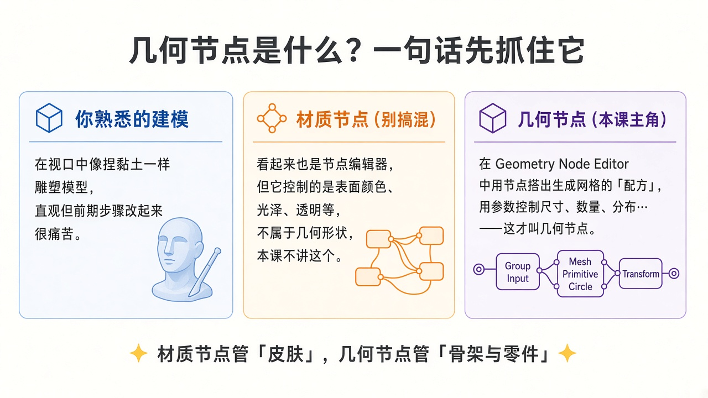
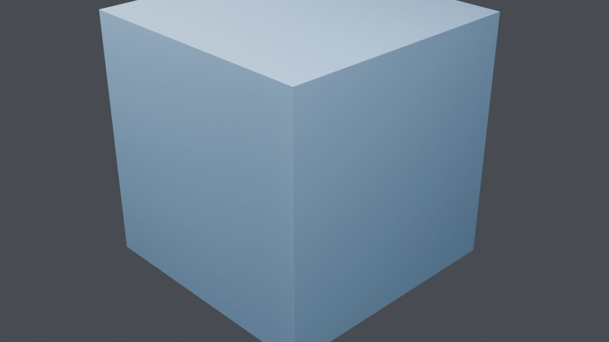
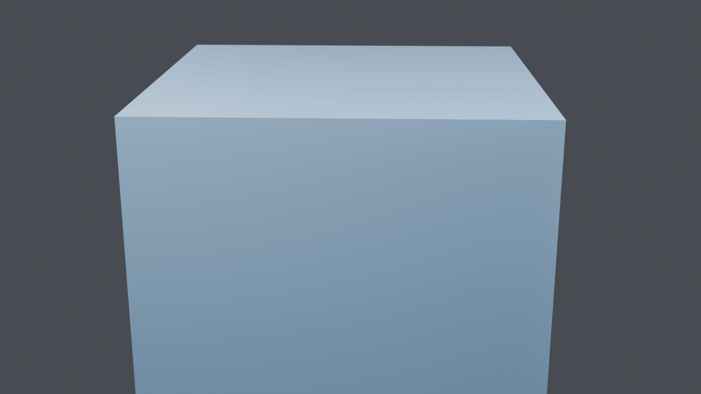
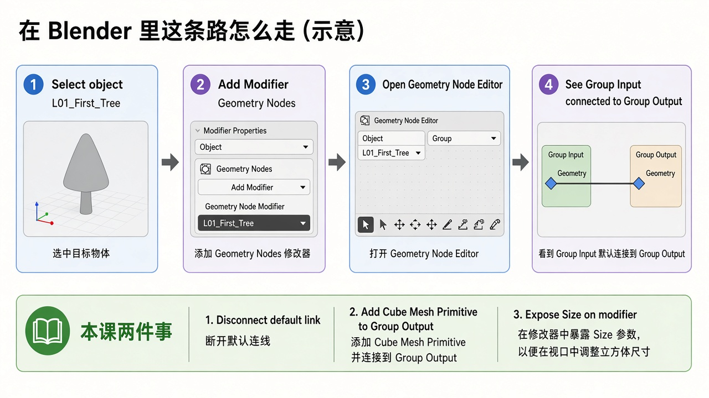
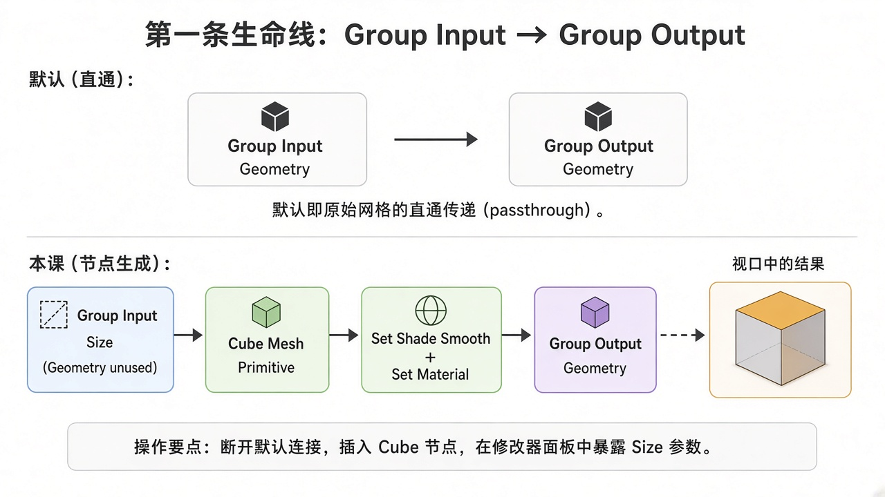

# 第 1 课 · 认识几何节点：它是什么、在哪打开、你的第一条节点树

> **版本说明（重要）**  
> 本课是按「几何节点从零开始」标准 **重写** 的新第 1 课，取代原先偏难的《几何流 vs 场》版本。  
> 旧版课件与案例已归档到 `lessons/archive/`、`blends/archive/`、`assets/L01/archive_old_hard_lesson/`，以后进阶课还会用到其中的思路，但 **今天请只学这一版**。  
> 目标软件：**Blender 5.2 LTS**（你云电脑上已安装）。节点名一律用 **英文官方名**，旁边用中文解释。

---

## 这节课你要带走什么

学完这一课，你应该能自信地说出下面五句话，并且亲手做到：

1. **Geometry Nodes（几何节点）** 是挂在物体上的一种 **修改器**：用节点图描述「几何怎么生成 / 怎么被改造」，不是材质节点。
2. 你会给物体添加 **Geometry Nodes** 修改器，并打开 **Geometry Node Editor（几何节点编辑器）**。
3. 你明白 **Group Input → Group Output** 是整棵树的「生命线」；新建时它们默认连着，等于 **原样输出物体自己的网格**。
4. 你会 **断开** 那条默认连线，加入一个 **Cube（Mesh Primitive / 网格基本体：立方体）**，让视口里出现的是 **节点算出来的立方体**。
5. 你知道修改器面板上的 **Size（尺寸）** 从哪来——它来自节点组接口里你暴露出去的输入。

**本课故意不讲：** Field（场）的深水区、Instance on Points、Align Rotation、Normalize 等等。那些都很好玩，但会放到后面的课，等你站稳了再上。

---

## 先讲个故事：为什么要学这个

你已经会 Blender 的基础操作了——移动视图、加物体、改材质、时间轴拉一拉，这些我们不再从头讲。

但如果你喜欢 **动态图形、有趣特效**，很快会碰到一种挫败感：

- 做一个「会呼吸的 Logo」：手工建模一次可以，要改尺寸、改密度、改节奏，就得拆掉重来。
- 做一排小方块围着球转：复制粘贴 20 次能交差，要改成 36 个还朝外站好，手会疯。

几何节点干的事，可以想成：**把「我怎么做这个模型」写成一份可调参数的菜谱**。  
菜谱改一口盐（一个数值），整道菜重新烧一遍——电脑不嫌烦，你也更自由。

今天我们不急着做大菜。我们只做一件事：  
**让你亲眼看见：视口里的立方体，可以完全由节点「生成」，而不是你在编辑模式里挤出来的。**

这听起来简单，却是后面所有炫技的地基。地基不稳，后面讲 Field、实例、曲线，都会像在听天书。

---

## 它和你熟悉的建模差在哪

请先看这张对照卡（浅色概念图）：

用大白话再说一遍：

| 方式 | 你在干什么 | 改早期决定难不难 |
|------|------------|------------------|
| 传统建模 | 在视口里点、挤出、布尔，像捏粘土 | 往往很难，历史一步步叠上去 |
| 材质节点（Shader） | 管「看起来怎样」：颜色、粗糙、透明 | 不管顶点够不够、面怎么长出来 |
| **几何节点** | 管「几何怎样生成 / 变形」 | 改参数就能重算，适合动效与复用 |

**记忆口诀：**  
材质节点管「皮肤」，几何节点管「骨架与零件」。  
本课只碰后者。你如果一不小心打开了 Shader Editor，看到彩色的 Principled BSDF，那是隔壁教室——关掉，回到 Geometry Node Editor。

---

## 案例文件：先打开看一眼结果

请先下载并打开案例文件：

案例文件：[L01_first_geometry_nodes_tree.blend](../blends/L01_first_geometry_nodes_tree.blend)

（若你在课程同步盘里学习，路径也常见为：`…/GeometryNodesCourse/blends/L01_first_geometry_nodes_tree.blend`）

场景里有一个物体，名字叫 **`L01_First_Tree`**。

选中它，看右侧 **Modifier Properties（修改器属性）**：

- 上面挂着一个 **Geometry Nodes** 修改器
- 修改器里有一个可拧的 **Size**（默认大约是 2.0）

拧一下 Size——视口里的立方体变大变小。  
恭喜：你已经在「遥控」一条节点树了，哪怕你还没读懂每一个插座。

再看两个渲染参考（就是这个案例在灯光下的样子，截图保持 Blender 原样）：

接下来我们把「这条树到底怎么长出来的」拆开讲。你可以对照案例自学，也可以按下面步骤从空白场景自己搭一遍——两种都有效，我更推荐 **至少自己搭一遍**，印象会深很多。

---

## 在界面里怎么走到几何节点（一步步）

下面假设：你会选中物体、切换编辑器类型、打开修改器面板。  
凡是 **和几何节点有关** 的步骤，我都写细一点。

先看一张「路线示意图」：

### 步骤 A：准备一个载体物体

1. 新建或打开一个场景。
2. 加一个任意网格物体也行（Cube、Plane 都可以）。  
   **关键认知：** 这个物体像一个「插座」——几何节点修改器要挂在某个物体上才能工作。  
   在本课案例里，物体叫 `L01_First_Tree`。它自己的网格几乎不重要，因为我们稍后 **不再输出它的原始网格**。

### 步骤 B：添加 Geometry Nodes 修改器

1. 选中物体。
2. 到 **Modifier Properties**（扳手图标那一页）。
3. **Add Modifier → Geometry Nodes**。  
   （不同 Blender 版本菜单分类可能略有出入，搜索框里输入 `Geometry` 一般就能找到。）

添加成功后，修改器里通常会出现一个节点组（有的版本会提示 New / 新建）。点 **New**，给节点组起个好认的名字，比如 `L01_First_Tree`。

### 步骤 C：打开 Geometry Node Editor

1. 把某个编辑器区域的类型改成 **Geometry Node Editor**（几何节点编辑器）。  
   不要选成 Shader Editor，也不要选 Compositor。
2. 确认左上角 / 头栏显示的是你刚才那个节点组，并且物体仍然被选中。  
   如果编辑器一片空白：多半是 **没选中带几何节点修改器的物体**，或者修改器还没指定节点组——回去检查步骤 B。

### 步骤 D：认识默认的「生命线」

新建几何节点组时，你几乎总会看到两个节点：

- **Group Input（组输入）** —— 左边，负责把「外面的东西」送进节点树  
- **Group Output（组输出）** —— 右边，负责把「算完的几何」送回修改器 / 视口  

默认情况下，它们之间有一根线，连的是 **Geometry → Geometry**。

这句话请慢慢读：

> **默认连线 = 物体原来长什么样，修改器就算完还输出什么样。**  
> 等于你装了一个「什么都没做」的几何节点修改器。它不是坏了，它只是在说：原样通过。

这就是生命线。后面所有花活，都是在这根线中间「插入工序」，或者像本课一样——**换一条水源**。

---

## 本课核心操作：断开默认线，改用 Cube 生成几何

请看生命线对照图：

### 步骤 E：断开默认连线

在 Geometry Node Editor 里：

1. 选中 **Group Input** 和 **Group Output** 之间那根 Geometry 连线。
2. 按删除键删掉它（或拖拽插头拔掉）。

这时候视口里物体可能会 **消失**（或变成空）。别慌——你只是暂时没有给 Output 任何几何。  
就像水管中间断了，下游没水。

### 步骤 F：加入 Cube（Mesh Primitive）

1. 在节点编辑器空白处，按快捷键 **Shift + A**（或用 Add 菜单）。
2. 找到 **Mesh → Cube**（有的菜单写作 Mesh Primitives / 网格基本体）。  
   官方节点名就是 **Cube**，类别属于 Mesh Primitive。
3. 把 Cube 节点放到 Input 和 Output 中间。
4. 把 Cube 的输出插座 **Mesh**，拖到 **Group Output** 的 **Geometry** 上。

视口里应该出现一个立方体。

**此刻发生了什么？**

- 你没有去编辑模式挤面。
- 立方体的顶点、边、面，是 **Cube 节点按参数生成** 的。
- 物体原始网格（Group Input 的 Geometry） **没有接到 Output**，所以它不出现在最终结果里。  
  它还在物体数据里睡着，只是这条节点树选择「不用它」。

这就是本课最重要的心法转换：

> 几何节点既可以 **改造** 原有几何，也可以 **完全生成** 新几何。  
> 今天我们选第二种，好让你看清：Output 里出来的东西，才是你最终看见的。

### 步骤 G：可选修饰（案例里有，但不是考点）

案例文件里，Cube 后面还接了：

- **Set Shade Smooth（设置平滑着色）** —— 控制面是否平滑着色；本课案例里保持不平滑，立方体棱角更清楚  
- **Set Material（设置材质）** —— 给生成出来的网格挂上一个材质，方便看清

它们的角色是「化妆」，不是「骨架」。你第一次自己搭时，**可以先省略**，直接 `Cube → Group Output` 也完全合格。

### 步骤 H：暴露 Size，让修改器面板能拧

现在立方体有了，但最好能在修改器上调大小，而不用每次点进节点里改。

1. 看 **Cube** 节点上的 **Size**（尺寸）输入。  
   在 Blender 5.2 里，Cube 常用一个统一的 Size；老一点的版本可能是 Size X / Y / Z。
2. 把 **Group Input** 里的一个浮点输出，连到 Cube 的 Size。  
   - 若 Group Input 还没有 Size：在节点组接口（Group 面板 / 界面 N 面板的 Group 页）里 **新增一个 Float 输入**，命名为 `Size`，设个默认值（比如 2.0）。  
   - 案例文件已经帮你做好了：接口里有 `Geometry`（闲置）和 `Size`（在用）。
3. 回到修改器面板：你应该能看到 **Size** 滑块。拧它，立方体跟着变。

**参数是从哪冒出来的？**

> 修改器面板上出现的那些输入，来自 **节点组接口（Group Interface）里标记为 Input 的插座**。  
> 你在接口里暴露什么，修改器就显示什么。  
> 本课只暴露一个 Size，够用了。

---

## 对照案例：每个节点为什么存在

打开案例 `L01_first_geometry_nodes_tree.blend`，节点组名也是 `L01_First_Tree`。从左到右大致是：

| 节点（英文名） | 中文旁注 | 它在本课的职责 |
|----------------|----------|----------------|
| **Group Input** | 组输入 | 提供 `Size`；`Geometry` 故意不接线，提醒你「原始网格这次不用」 |
| **Cube** | 立方体（网格基本体） | 真正「造」出网格的地方 |
| **Set Shade Smooth** | 设置平滑着色 | 可选；让着色方式明确 |
| **Set Material** | 设置材质 | 可选；挂上蓝色材质方便观看 |
| **Group Output** | 组输出 | 生命线终点；只有接到这里的几何才会出现在视口 |

另外还有一个 **Frame（框）**，标签写着本课提醒：用节点造立方体，不走原始网格。框不参与计算，只是注释。

**特意没有做的事（请放心）：**

- 没有 Instance on Points  
- 没有对齐旋转、没有噪声、没有场数学  
- 没有把原始 Geometry 和 Cube Join 在一起  

那些是后面课程的戏份。

---

## 两种思路的对比（帮你建立直觉）

### 思路 1：直通（默认）

`Group Input.Geometry → Group Output.Geometry`

物体长什么样，输出还什么样。适合「我要在原有模型上继续加工」的起点。

### 思路 2：节点生成（本课默认可见结果）

`Cube.Mesh → … → Group Output.Geometry`  
（Group Input.Geometry 闲置；Size 驱动 Cube）

视口完全由节点生成。适合「从零程序化」的起点，也适合教学：因为结果干净，你不会怀疑「这是不是物体自带的网格」。

以后你常会把两种思路 **混用**：既吃一点原始几何，又生成新零件，再用 **Join Geometry（合并几何）** 拼起来。那是后话。

---

## 常见卡点（几乎每个初学者都会遇到）

### 1. 几何节点编辑器是空白的

- 物体没选中  
- 修改器里还没有节点组（点 New）  
- 编辑器类型选错成了 Shader / Compositor  

### 2. 断开默认线之后，物体消失了

正常。Output 没接到任何 Geometry，下游没东西可显示。把 Cube 的 Mesh 接上 Output 即可。

### 3. 加了 Cube，但看起来没变化 / 还是原来的形状

- 是不是 **默认的 Input→Output 线还在**，同时 Cube 也接上了？有的情况要以实际连接为准，检查 Output 到底吃的是哪根线。  
- 是不是修改器被禁用（显示器图标关掉了）？  
- 是不是看错了物体？

### 4. 修改器面板没有 Size

- Size 只存在于 Cube 节点内部，还没有连到 Group Input，也没有在接口里创建同名输入。  
- 去 Group 接口里确认有一个 Float 输入叫 Size，并且有连线进 Cube。

### 5. 我和案例颜色不一样

完全没关系。材质只是为了好看。本课考核的是 **树的结构**，不是调色。

### 6. 我误进了编辑模式去改立方体

几何节点生成的网格，在修改器还在时，通常不是你去编辑模式「永久改形」的对象。本课请留在物体模式，拧 Size，观察节点结果。

---

## 小练习（做完才算真正上完课）

请务必动手，不要只看：

1. **拧 Size**  
   把 Size 调到 0.5、1.0、3.0，感受「参数 → 重算几何」的即时反馈。

2. **换成 Ico Sphere（二十面球体）**  
   - 删掉或旁路 Cube  
   - Shift+A → Mesh → **Ico Sphere**  
   - 把它的 Mesh 接到通往 Output 的链上  
   - 试试它的 **Radius（半径）**、**Subdivisions（细分）**  
   做完你会发现：换基本体，只是换「水源」，生命线的逻辑不变。

3. **（可选）对比实验**  
   临时把 `Group Input.Geometry` 直接连回 `Group Output.Geometry`（断开 Cube）。  
   看看视口变成什么——那就是「直通原始网格」。再改回 Cube 方案。  
   对比一次，比听十句解释都清楚。

---

## 收工检查清单

- [ ] 能用自己的话区分：几何节点 vs 材质节点 vs 传统建模  
- [ ] 会添加 Geometry Nodes 修改器并打开 Geometry Node Editor  
- [ ] 理解 Group Input / Group Output 默认直通的含义  
- [ ] 会断开默认线，用 Cube 生成可见立方体  
- [ ] 修改器上能看到并可调节 Size  
- [ ] 完成「换成 Ico Sphere」小练习  

---

## 下节预告

第 2 课会继续放慢速度，专门讲：

**怎么读节点编辑器** —— 插座颜色、实线、节点上的输入输出、Viewer（查看器）怎么当手电筒用。  

仍然不讲 Field 深水；我们先把「看懂一张节点图」练成肌肉记忆。

---

## 本课文件一览

| 类型 | 路径 |
|------|------|
| 课件 | `lessons/L01_first_geometry_nodes_tree.md` |
| 案例 | `blends/L01_first_geometry_nodes_tree.blend` |
| 配图 | `assets/L01/`（视口 ×2 + 概念图 ×3） |
| 旧版归档 | `lessons/archive/`、`blends/archive/`、`assets/L01/archive_old_hard_lesson/` |

Google Drive 同步文件夹：课程根目录 `GeometryNodesCourse`（与云电脑同结构）。

---

*L01 · 从零认识几何节点 · Blender 5.2 LTS*
