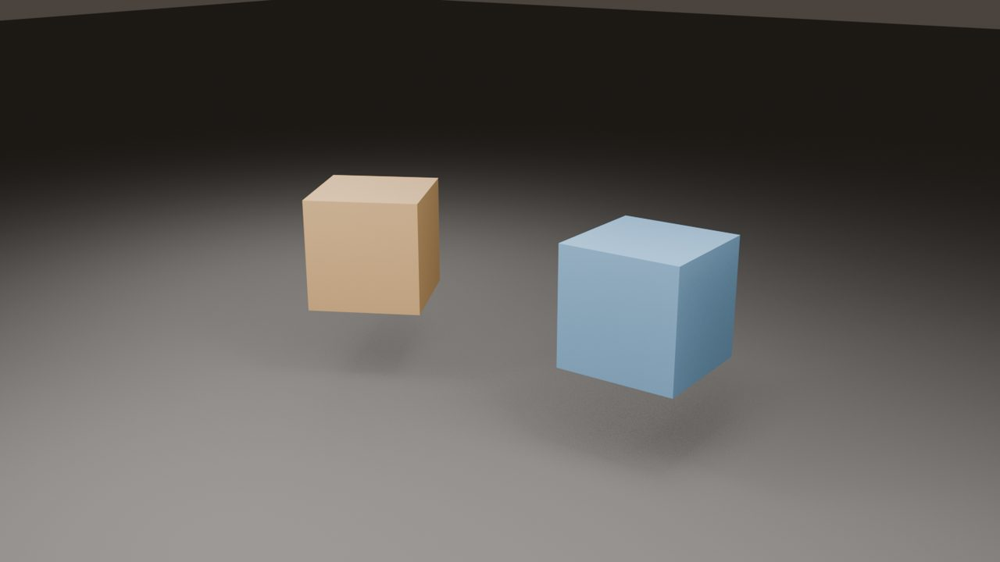
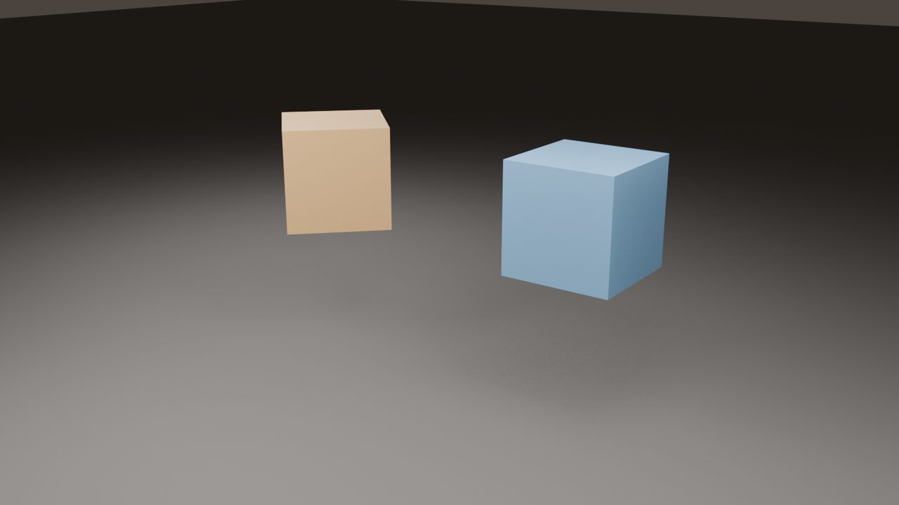
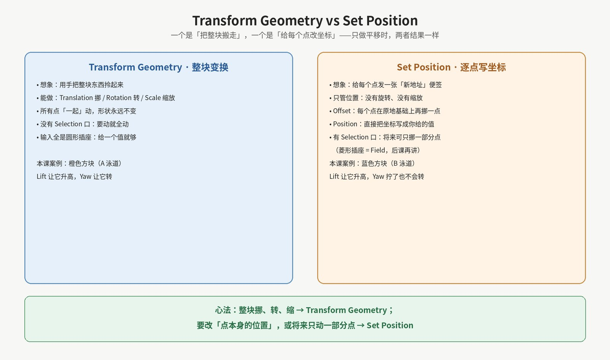
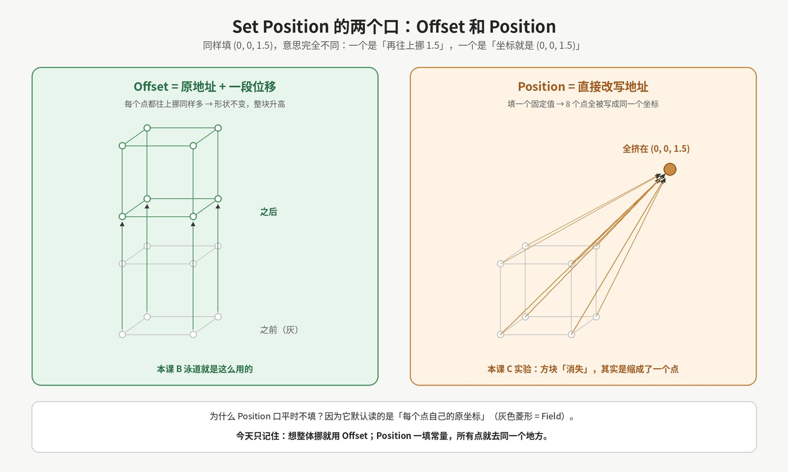
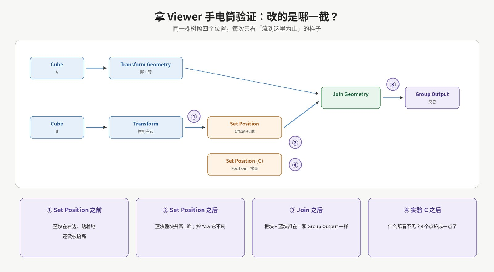

# 第 4 课 · Set Position 与 Transform Geometry：整块搬走 vs 给每个点改地址

> **衔接说明**  
> 第 1 课：你打开了 **Geometry Node Editor**，造出第一块网格。  
> 第 2 课：你用 **Transform Geometry** 把东西整块挪、转、缩，用 **Join Geometry** 拼成一件。  
> 第 3 课：你学会读插座颜色和连线，还学会用 **Viewer**（查看器）当手电筒，照看树中间某一截。  
> 今天我们认识一个新节点 **Set Position**（设置位置），并且把它和老朋友 Transform Geometry 摆在一起比一比：  
> **它们都能让东西「动起来」，到底差在哪？什么时候该用哪个？**  
> 全程仍然**不讲 Field 公式**，只用最朴素的「填一个数」来做对比，并用 Viewer 举证。  
> 目标软件：**Blender 5.2 LTS**。节点名用 **英文官方名**，旁边用中文解释。

---

## 这节课你要带走什么

学完这一课，你应该能自信地说出并亲手做到：

1. **说清两者的分工**：Transform Geometry 是「把整块拎起来搬走 / 转 / 缩」；Set Position 是「给每个点改坐标」，它只管位置，不会旋转、不会缩放。
2. **会用 Set Position 的 Offset 口**：给它一个向量，让每个点都在原地再挪同样一段，结果就是整块平移。
3. **认识 Position 口的「坑」**：如果往 Position 口里填一个固定值，所有点都会被写到同一个坐标，物体看起来就「消失」了。
4. **会用 Viewer 验证**：分别照「Set Position 之前」「之后」「Join 之后」，用视口亲眼确认改的是哪一截。
5. **知道为什么要学 Set Position**：它有一个 Transform 没有的 **Selection** 口，将来能「只挪一部分点」，这是做波浪、碎裂、生长动画的起点（后课讲）。

**本课故意不讲：** Field 怎么算、Position 节点、数学节点、噪波。Selection 和菱形插座今天只「认个脸」。

---

## 先讲为什么：既然 Transform 能挪，干嘛还要 Set Position？

上一课结束时，你已经能用 Transform Geometry 把方块抬高、转个角度。  
这时候冒出一个很自然的问题：

> 「我已经会挪了，为什么节点菜单里还有一个 Set Position？它也是挪东西的吗？」

答案是：**是，也不是。**

- 如果你只是想把**整块**东西往上抬 0.8 米，两个节点都能做到，结果一模一样。
- 但它们「想事情的方式」完全不同：  
  **Transform Geometry 把整块当成一个整体**，像你用手把一个纸盒拎起来；  
  **Set Position 把东西拆成一个个点**，给每一个点发一张「新地址」便签。

现在看起来像是绕远路，但「每个点单独发地址」这件事，正是几何节点最强大的地方：  
以后你想让一块平面像水面一样起伏、让一排柱子高低不齐、让一个球表面鼓起来——都是 Set Position 的活，Transform 做不到，因为它只会「全体一起动」。

今天我们先把边界立住：**只做整体平移时两者等价；一旦涉及旋转缩放，用 Transform；一旦想动「点本身」，用 Set Position。**

---

## 案例先打开：先看结果，再拆菜谱

请先下载并打开案例文件：

案例文件：[L04_set_position_vs_transform.blend](../blends/L04_set_position_vs_transform.blend)

场景主物体名：**`L04_SetPos_vs_Transform`**。  
节点组名：**`L04_SetPosition_vs_Transform`**。

选中物体，看 **Modifier Properties**（修改器面板），你会看到两个旋钮：

| 参数 | 默认 | 你拧它时会发生什么 |
|------|------|--------------------|
| **Lift** | 0.8 | 橙块和蓝块**一起**升高或降低（单位：米） |
| **Yaw** | 0.5 | **只有橙块**绕 Z 轴转；蓝块纹丝不动（单位：弧度，0.5 ≈ 29°） |

案例渲染参考（Eevee 棚拍光，**保持原样**）：

> 观察要点：  
> - 两块方块**高度永远一样**——因为 Lift 同时喂给了两边。这说明「只做平移时，Transform 和 Set Position 效果相同」。  
> - Yaw 只影响橙块——因为 Yaw 只接在 Transform Geometry 的 Rotation 上，Set Position 根本没有旋转这个口。  
> 你本机主题、角度不同，颜色阴影略有差别完全正常。

打开 Geometry Node Editor，节点组里有三个用 **Frame**（框）圈起来的区域：

- **A 泳道（上）**：Cube → Set Material → **Transform Geometry**（挪 + 转）
- **B 泳道（中）**：Cube → Set Material → Transform Geometry（只负责摆到右边）→ **Set Position**（Offset 往上抬）
- **C 实验（下）**：Cube → **Set Position**（Position 口写死一个坐标）→ **Viewer**（默认静音）

A 和 B 在 **Join Geometry** 汇合，交给 **Group Output**。C 不进 Join，它是专门留给你做实验的。

---

## 概念一：Transform Geometry 和 Set Position 各自在想什么

请先看概念图：

### Transform Geometry：整块变换

你在第 2 课已经很熟了，我们只复习它的「性格」：

- 它看到的是**一整块东西**。
- 它有三个旋钮：**Translation**（挪）、**Rotation**（转）、**Scale**（缩放）。
- 不管你怎么拧，所有点都是**一起**动的，所以形状永远不会被拉歪。
- 它**没有 Selection 口**：要么全动，要么不动，不能只动一半。

### Set Position：给每个点改地址

这是今天的新朋友。添加方法：在节点编辑器里按 `Shift+A`，在 **Geometry → Write** 分类里找到 **Set Position**（也可以直接按 `Shift+A` 后输入 `Set Position` 搜索）。

它有四个输入口，从上到下：

| 输入口 | 插座样子（颜色 / 形状） | 中文意思 | 今天怎么用 |
|--------|------------------------|----------|------------|
| **Geometry** | 青蓝 / **方口** | 要被修改的几何 | 接主水管 |
| **Selection** | 同色 **菱形**（Field） | 哪些点要被改 | **不动它**，默认是「全部点」 |
| **Position** | 同色 **菱形**（Field） | 每个点的**新坐标** | 今天只在实验 C 里碰它 |
| **Offset** | 同色 **菱形**（Field） | 在原坐标上**再加**多少 | 今天的主角 |

记住第 3 课改过的规则：**颜色 = 类型，形状另说一件事**——Geometry 是青蓝方口；Selection / Position / Offset 才是菱形，因为它们能接受 Field（「每个点一张便签」）。  
今天我们不往菱形口里接任何复杂的东西，只给它一个**固定的数**——这时候它就像普通的圆形插座一样，所有点拿到的便签内容都一样。

### 一句话对比

> **Transform Geometry 搬的是「整块」；Set Position 改的是「每一个点」。**  
> 当每个点都改同样多的时候，看起来就像整块被搬走了——这就是今天 A、B 两块方块一样高的原因。

---

## 概念二：Offset 和 Position，填同样的数，结果天差地别

请看概念图：

这是今天最容易踩的坑，请慢慢读。

### Offset：原地址 + 一段位移

把 Offset 填成 `(0, 0, 0.8)`，意思是：

> 「每个点，请在你**原来的位置**上，再往 Z 方向挪 0.8。」

方块的 8 个角都往上挪 0.8，它们之间的相对位置没变，所以形状不变，整块升高。  
这和 Transform Geometry 的 Translation 填 `(0, 0, 0.8)` 结果一模一样。

### Position：直接改写地址

如果你把 `(0, 0, 1.5)` 填进 **Position** 口（而不是 Offset），意思就变成了：

> 「每个点，请把你的坐标**改成** (0, 0, 1.5)。」

注意，是「改成」，不是「再加」。8 个角全部被写成同一个坐标，于是它们全挤在一个点上——方块在视口里就「消失」了。它其实还在，只是缩成了一个看不见大小的点。

### 那 Position 口平时为什么能正常工作？

你在新加的 Set Position 节点上会发现，Position 口旁边**没有可以填数字的框**。  
这是因为它默认读的是「每个点自己的原坐标」——相当于「把你的地址改成你原来的地址」，所以什么都不变。  
这个「默认读自己的原坐标」就是 Field 的行为，深讲留到后面的课。今天只记住：

> **想整体挪，用 Offset。Position 一旦填了固定值，所有点都会去同一个地方。**

---

## 手把手：自己从零搭一遍 B 泳道

案例文件里已经搭好了，但请你在**同一个文件里另外搭一份**，手熟比眼熟重要。

### 步骤 A：准备一块方块

1. 在 3D 视口按 `Shift+A` → **Mesh → Cube** 新建一个方块，按 `G` `X` 把它挪到一边，别和案例重叠。
2. 切到 **Geometry Nodes** 工作区（或任意一个区域改成 Geometry Node Editor），点 **New** 新建节点组。  
   你会看到熟悉的 **Group Input → Group Output**，中间连着一根 Geometry 线。

### 步骤 B：插入 Set Position

1. `Shift+A` → 搜索 `Set Position`，添加节点。
2. 把它**拖到** Group Input 和 Group Output 之间那根线上，看到线变亮后松手——Blender 会自动帮你接好：  
   Group Input 的 Geometry → Set Position 的 Geometry；Set Position 的 Geometry → Group Output。
3. 此时视口里方块**没有任何变化**。这是对的：Offset 默认是 `(0, 0, 0)`，Position 默认读原坐标，等于什么都没改。

### 步骤 C：用 Offset 把方块抬起来

1. 在 Set Position 节点上找到 **Offset**，点开它的小三角或直接看到 X / Y / Z 三格。
2. 把 **Z** 改成 `1`。
3. 视口里的方块整块升高 1 米。

### 步骤 D：试着「转」它——你会发现做不到

1. 在 Set Position 上找一找：有没有 Rotation 或 Scale？——**没有。**
2. 这就是它和 Transform Geometry 最直观的区别：Set Position **只管位置**。  
   要转、要缩，请在它前面或后面接一个 **Transform Geometry**。

### 步骤 E：用 Transform Geometry 做同样的事，对比一下

1. 再加一个 **Transform Geometry**，接在 Set Position 后面。
2. 先把 Set Position 的 Offset Z 改回 `0`，然后把 Transform Geometry 的 **Translation Z** 改成 `1`。
3. 方块升高的高度和步骤 C 完全一样。  
   **结论：只做平移时，两者等价。**
4. 再拧 Transform Geometry 的 **Rotation Z**，方块转起来了——这是 Set Position 做不到的。

---

## 手把手：用 Viewer 举证，改的到底是哪一截

请看概念图：

回到案例节点组 `L04_SetPosition_vs_Transform`。我们用第 3 课学的手电筒，照四个位置：

### 位置 ①：B 泳道 Set Position **之前**

1. 按 `Shift+A` → **Output → Viewer** 加一个新的 Viewer（或者 `Ctrl+Shift+点击` 节点，Blender 会自动挂上）。
2. 把 B 泳道里「Transform Geometry（只负责摆到右边）」的 Geometry 输出接到 Viewer。
3. 视口里应该看到：**蓝块在右边，贴着地面，还没升高**。

### 位置 ②：B 泳道 Set Position **之后**

1. 把 Viewer 改接到 **Set Position (B)** 的 Geometry 输出。
2. 视口：**蓝块升高了 Lift 那么多**。
3. 去修改器面板拧一下 **Yaw**——蓝块不会转。这再一次说明：Set Position 只管位置。

### 位置 ③：Join 之后

1. 把 Viewer 改接到 **Join Geometry** 的输出。
2. 视口：橙块 + 蓝块都在，和 Group Output 的最终结果一样。

### 位置 ④：实验 C

1. 找到最下面的 **C 实验**框，里面有一个已经接好、但被**静音**（Mute）的 Viewer。
2. 选中它，按 `M` 取消静音（如果你刚才加的 Viewer 还开着，先把那个按 `M` 静音，免得两个手电筒抢镜）。
3. 视口：**好像什么都没有？** 这就对了。C 实验的 Set Position 把 Position 写成了 `(0, 0, 1.5)`，方块的 8 个点全被挤到了同一个位置。
4. 想确认「它确实还在，只是缩成一点」？可以把 C 实验里那个 Vector 节点的值改一改——不管改成什么，都只会是一个点换个地方，永远变不回方块。
5. 看完后再按一次 `M` 把它静音，视口回到最终结果。

> **养成习惯：查完就静音。** 视口里少了东西时，先看看是不是有个手电筒还开着。

---

## 小练习（做完才算上完课）

1. **把 Offset 换成负数**  
   把 B 泳道里 Lift 调成 `-0.3`。蓝块和橙块会一起往下沉，部分陷进地面。说出为什么两块总是一样高。

2. **让 B 泳道也能转**  
   在 B 泳道的 Set Position **后面**加一个 Transform Geometry，把 Rotation Z 拧到 `0.5`。  
   注意：它会绕**世界原点**转，而蓝块不在原点上，所以它会「公转」着跑开一段，而不是原地自转。  
   想一想：橙块为什么是原地自转？（提示：A 泳道里，挪和转写在同一个 Transform Geometry 里，Blender 会先转再挪。）

3. **Position 坑再踩一次**  
   在你自己搭的那份 Set Position 上，把一个 **Vector** 节点（`Shift+A` → **Input → Constant → Vector**）接到 **Position** 口。  
   用 Viewer 照它，确认方块缩成一个点。然后把线挪到 **Offset** 口，方块恢复成整块平移。用一句话说出两个口的区别。

4. **（可选）找一找 Selection**  
   Set Position 上的 **Selection** 口现在是勾选状态（代表「全部点」）。把它取消勾选，会发生什么？  
   答案：一个点都不改了，Offset 失效。下下节课我们会给它接真正的「选择条件」，让它只挪一部分点。

---

## 常见卡点

### 1. 加了 Set Position，方块一点都没动

- 正常！Offset 默认 `(0, 0, 0)`，等于没挪。去改 Offset 的 Z。
- 检查 **Selection** 是不是被取消勾选了。

### 2. 方块突然「不见了」

- 你很可能把数字填进了 **Position** 口，而不是 **Offset** 口。所有点被写到了同一个坐标。
- 也可能有个 Viewer 还开着，正照着实验 C。先找找有没有没静音的 Viewer。

### 3. Set Position 上找不到 Rotation 和 Scale

- 它本来就没有。转和缩请交给 **Transform Geometry**。

### 4. Transform 和 Set Position 的结果为什么一样？我是不是做错了

- 没做错。只做平移、且所有点挪一样多的时候，两者就是等价的。今天要体会的正是「等价的边界在哪」。

### 5. Position 口旁边没有数字框，我填不了值

- 那是因为它默认读「每个点自己的原坐标」（这是 Field 的行为）。要填固定值，得像实验 C 那样从外面接一个 Vector 节点进来。不过今天的主战场是 Offset。

### 6. 我想现在就学「只挪一部分点」

- 先忍住。那需要给 Selection 接一个真正的条件，就要用到 Field。我们按从零的节奏走，先把今天的边界立稳。

---

## 收工检查清单

- [ ] 能用一句话说出 Transform Geometry 和 Set Position 的区别  
- [ ] 知道只做平移时两者等价，而旋转、缩放只能交给 Transform  
- [ ] 会用 Set Position 的 **Offset** 把整块平移  
- [ ] 知道往 **Position** 填固定值会让所有点挤成一点  
- [ ] 会用 Viewer 照「Set Position 之前 / 之后 / Join 之后」，用视口举证  
- [ ] 完成至少三道小练习

---

## 下节预告

第 5 课我们终于要轻轻推开 Field 的门，但会非常慢：

**Position 节点与「每个点都不一样」：第一次让点各挪各的**

- 今天的 Offset 给所有点的都是同一个数，所以整块平移。
- 下一课我们用 **Position** 节点读出「每个点自己在哪」，再把它喂回 Set Position，让高处的点和低处的点挪得不一样——方块会第一次被「拉歪」。
- 仍然全程用 Viewer 和 Spreadsheet（表格编辑器）验证，一步一步来。

---

## 本课文件一览

| 类型 | 路径 |
|------|------|
| 课件 | `lessons/L04_set_position_vs_transform.md` |
| 案例 | `blends/L04_set_position_vs_transform.blend` |
| 配图 | `assets/L04/`（渲染参考 ×2 + 概念图 ×3） |
| 脚本 | `scripts/create_L04.py`、`scripts/gen_l04_illustrations.py` |

Google Drive 同步文件夹：课程根目录 `GeometryNodesCourse`（与云电脑同结构）。

---

*L04 · Set Position vs Transform Geometry · Blender 5.2 LTS*
